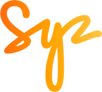

# Syz equity note

Use this skill whenever a Syz equity note is requested: an ad-hoc opinion on a stock or sector, a review of an investor's existing positions, or an earnings update. The audience is Wealth Management clients, so the tone is clear and retail-friendly unless a more sophisticated case is asked for. Notes are written in English unless told otherwise.

## 1. Workflow

1. **Gather and verify the facts before writing.** Treat research packs, AI summaries and broker notes as leads, not facts. Check every figure that matters (results, guidance, deliveries, job cuts, recalls, deal terms) against the company's own publications (press releases, ad hoc notices, annual and interim reports) or reliable press. Drop what cannot be confirmed and tell the author what was dropped and why.
2. **Prices:** use the last official close the author gives (usually Bloomberg). State the date on the cover ("Prices are as of the close on DD Month YYYY"). If a chart or technical take was produced earlier, say so ("Charts as of the week of ...").
3. **Corporate actions (offers, mergers, buy-outs):** rely only on the official communication. Quote its terms (price formula, payment form, timing, squeeze-out, stakes) and do not add your own estimates, sensitivities or scenario tables unless asked.
4. **Own calculations** (e.g. a holding discount or NAV) are allowed when the method is simple and the inputs are official; show the method to the author and label it "Syz calculation" in the sources.
5. Draft the text, let the author read it, then lay it out. Check that every page fits on one A4 page with no overflow before delivering.

## 2. Editorial rules

- **No broker names**, no analyst names, no sell-side ratings, **no target prices** and no ANR. Use broker research only as background; never reproduce a broker's proprietary analysis (estimates paths, search-trend data, sector growth assumptions). Rebuild the argument from company data and our own calculations.
- **Never show an investor's entry price, unrealised loss or the rise needed to break even.** It hurts the reader and is irrelevant to the decision: the question is always the potential from today's price.
- Say "an investor", never "the client". Do not write "client question" or "answers to client question".
- No labels such as "Our view" or "Profile". No ALL-CAPS titles, no dashes used as separators, no "what the chart says" phrasing.
- **Fundamentals come first.** Technical levels are illustrative reference points, phrased with "could" ("a move back above EUR X could confirm the improvement", "EUR Y is the level to watch on the downside"). Never make an entry or exit conditional on a chart level alone. Do not write the sentence "the fundamentals remain more important"; let the structure show it.
- When a stock has been in a multi-year downtrend, a technical box adds little; ask whether to include it.
- Be explicit about the house view when there is one ("We remain negative on European carmakers"), and make the structure consistent with it (order of strategies, conclusions, value-trap framing).
- Avoid "hold" as a lazy default. When reviewing positions, offer **two or three distinct strategies** (e.g. patience, simplify, reduce gradually on rebounds, rotate) with a clear trade-off each, and point out overlapping exposures (e.g. Dior and LVMH, Porsche SE and Volkswagen). Flag the risk of chasing performance when suggesting a rotation.
- Avoid peremptory statements; prefer "could" and "would" for forward-looking calls.
- **Focus List status:** every note states whether each company covered is on the Syz Focus List, in one sentence on the cover just after the price date line ("Prices are as of the close on DD Month YYYY. Astera Labs is not on the Syz Focus List." or "... is on the Syz Focus List."). In a note covering several companies, name each one. Ask the author when the status is not known; never guess it.
- Sources stay simple: "Syz Research, Bloomberg", company publications by name and date, "press reports" for labour or media items. No links on the page.

## 3. Page set

A4 pages of 794 x 1123 px (CSS), one HTML file per page, exported to PDF. Keep margins wide and use boxes and lines to separate sections and give the reader breathing room.

**Ad-hoc opinion / review of positions**
1. Cover: section label, headline, date line, important notice, sector section in two columns ending with "What this means for investors".
2. Possible strategies (reviews only): intro stating the absence or presence of catalysts, two or three strategy cards, and an "In every case" box.
3. One fiche per company: name and ticker, one-line orange subtitle, four KPI tiles, optional technical box, two columns with numbered sections (1. What the company does, 2. Why it could do well, 3. What sets it apart, 4. Is the share cheap? or Cheap, or a value trap?, 5. Main risks, 6. What to watch next) and a Conclusion block.
4. Charts page (optional): one or two charts with a caption and "Source: Syz Research, Bloomberg".
5. Sources and Important information (the disclaimer below, verbatim).

**Earnings update**
1. Section label "Earnings update · Sector", headline, date line "DD Month YYYY · Syz Research".
2. Key takeaways with coloured labels: Beat (Mint Green), Miss (Tiger Orange), Watch (Tiger Orange), Valuation (Blueberry Blue).
3. A boxed row of four KPIs, each with a comparison line ("+8% vs. consensus" in Mint Green, "-17% vs. consensus" in Tiger Orange).
4. Narrative section, Chart 1 (reported vs. consensus bars), Base case and implications, then two columns "What would strengthen our view" and "What would change our view".
5. Page 2 onwards: "Beyond the key takeaways" (Results, Outlook), then sources and disclaimer.

## 4. Visual identity (Syz Visual Guidelines)

### Colour palette

Primary palette (use tints at 75%, 50% and 25% when more shades are needed):

| Name | HEX | RGB | Use in notes |
|---|---|---|---|
| Tiger Orange | #FF6C0E | 255 108 14 | Accents, negative figures, Miss and Watch labels, subhead 2, first chart series |
| Mango Amber | #FFA400 | 255 164 0 | Middle stop of the orange gradient, second chart series |
| Gold Yellow | #FFC545 | 255 197 69 | End of the orange gradient, chart series |
| Blueberry Blue | #4B5F80 | 75 95 128 | Section labels, table column headers, chart series, Valuation label |
| Space Blue | #202945 | 32 41 69 | Body text, headings, **box frames**, axis lines, footer |

Secondary palette, for extra chart series or semantic colour only: Mint Green #3BAF90 (positive figures, Beat label), Teal Green #9DD9D2, Sky Blue #79D6FF, Peach Pink #E6A4AD, Mulberry Pink #AC5D85.

Gradients:
- **Orange gradient:** Tiger Orange 0%, Mango Amber 50%, Gold Yellow 100% → `linear-gradient(90deg,#FF6C0E 0%,#FFA400 50%,#FFC545 100%)`. Used for the header bar, headlines and standard-table title bands.
- **Blue gradient:** Space Blue 0% to Blueberry Blue 100% → `linear-gradient(90deg,#202945 0%,#4B5F80 100%)`. Reserved for decorative accents; never as a background behind body text in a note.

Background is always white.

### Typography

- Primary font is **Maison Neue** (Bold and Light). Use it when it is installed (PowerPoint, InDesign). For HTML and web output use the web-safe family **Nunito** (Google Fonts), Bold for emphasis and Light or Regular for text.
- Hierarchy (from the guidelines, scaled for A4):
  - **Section label:** Light, Blueberry Blue, uppercase, wide tracking (letter-spacing about 0.4em), 9 to 10 px. Example: "EARNINGS UPDATE · INDUSTRIALS".
  - **Headline:** Bold, sentence case, filled with the orange gradient, 26 to 30 px.
  - **Subhead 1:** Light, Space Blue, sentence case, 15 to 17 px (date line, intro lines).
  - **Subhead 2:** Bold, Tiger Orange, sentence case, 13 to 14 px (in-page headings such as "What would strengthen our view").
  - **Section headings in the body** (e.g. "Key takeaways", "Base case and implications"): Bold, Space Blue, 16 to 18 px.
  - **Paragraph:** Nunito 400 (or Maison Neue Light), Space Blue, 12.5 to 13.5 px, line-height 1.5, justified.
- Footer: 10.5 px, Space Blue, "Syz Research · <Note type> · DD Month YYYY" left, "n / N" right.

### Logo

- Use the primary logo, the **Sunburnt signature** (orange gradient), at the top right. Secondary versions: Mango Orange, black or white, only where the gradient cannot be used.
- Respect the clear space around the logo; minimum width 40 px on screen and 8 mm in print. About 46 px high on inner pages and 70 px on a cover.
- The logo file is `syz-logo.png` in this folder (official file name: Syz-logo-RGB-vignette).

### Header

Logo top right, then a 4 px bar with the orange gradient across the page width. Side margins 48 to 56 px.

### Boxes

- **No filled boxes.** Every box (KPI row, technical box, "In every case" box, key callouts, chart frames) has a **white background and a Space Blue (#202945) frame**, 1.5 to 2 px, with Space Blue text.
- Round the corners, following the guidelines' box style (35 px on slides, scaled to about 14 px on A4 notes).
- Labels inside a box are small Tiger Orange text, letter-spaced (or Blueberry Blue for neutral labels such as KPI names). Cells inside a box are separated by 1 px light grey (#D9D9D9) lines.
- Never use a Space Blue or gradient fill behind text.

### Tables

- **Standard table** (when it is the only table or graph on the page): title band with the orange gradient and white Bold uppercase title; column headers Blueberry Blue, Bold uppercase, small; rows alternating #D9D9D9 and #F2F2F2; body Light, Space Blue.
- **Compact table** (busy pages or supporting information): title in Tiger Orange Bold uppercase; column headers Blueberry Blue Bold uppercase; Space Blue rule above and below the body, thin rules between rows; no fills.

### Charts (data display)

- Series colours in this order: Tiger Orange, Gold Yellow, Space Blue, Blueberry Blue, then the secondary palette. In consensus-surprise bar charts, positive bars Blueberry Blue and negative bars Tiger Orange.
- Graph title centred above the plot, Light, Space Blue. Axis titles Bold italic uppercase, small. Thin Space Blue axis lines with tick marks; no top or right spines; light grid only if needed.
- Legend on the right: a square colour marker, the variable name in Bold uppercase in the series colour, and a short supporting line in Light below.
- Charts are built from the author's data (Bloomberg exports), never pasted as Bloomberg screenshots. In the note: "Chart 1 · <Ticker>: <what it shows>" with "Chart 1" in Tiger Orange, a Blueberry Blue subtitle line explaining the measure, the chart inside a framed box, and "Source: Syz Research, Bloomberg" below.

```python
import matplotlib.pyplot as plt
SPACE, BLUEBERRY, TIGER, MANGO, GOLD, MINT = '#202945', '#4B5F80', '#FF6C0E', '#FFA400', '#FFC545', '#3BAF90'
plt.rcParams.update({'font.family': 'Nunito', 'font.size': 10, 'text.color': SPACE,
                     'axes.edgecolor': SPACE, 'axes.labelcolor': SPACE, 'xtick.color': SPACE, 'ytick.color': SPACE})
# fall back to DejaVu Sans if Nunito is not installed
fig, ax = plt.subplots(figsize=(10, 5.6), dpi=180)
# lines: price in SPACE, 200-day average in TIGER, last price in a white label framed in SPACE at the right edge
# bars: positive in BLUEBERRY, negative in TIGER, value labels above or below each bar
for s in ('top', 'right'): ax.spines[s].set_visible(False)
ax.set_title('Graph title', fontsize=12, fontweight='light')
ax.set_xlabel('X AXIS', fontweight='bold', style='italic'); ax.set_ylabel('Y AXIS', fontweight='bold', style='italic')
fig.savefig('chart.png', facecolor='white')
```

### HTML skeleton

```html
<div class="page">
  <header><div class="bar"></div></header>
  <div class="label">Earnings update · Industrials</div>
  <h1 class="headline">ABB Q3 2026: record orders, a higher bar</h1>
  <div class="sub1">20 October 2026 · Syz Research</div>
  <div class="box grid4">
    <div><div class="boxlabel">Technical trend</div><div class="boxvalue">Bearish</div></div>
    <div><div class="boxlabel">Support</div><div class="boxvalue">EUR 65.92</div></div>
    <div><div class="boxlabel">Resistance</div><div class="boxvalue">EUR 73.9 / 83.8</div></div>
    <div><div class="boxlabel">Trend would change above</div><div class="boxvalue">EUR 84.8</div></div>
  </div>
  ...
  <footer><span>Syz Research · Earnings update · 20 October 2026</span><span>1 / 4</span></footer>
</div>
```

```css
@import url('https://fonts.googleapis.com/css2?family=Nunito:wght@300;400;700;800&display=swap');
:root{--space:#202945;--blueberry:#4B5F80;--tiger:#FF6C0E;--mango:#FFA400;--gold:#FFC545;--mint:#3BAF90;--line:#D9D9D9;
  --grad-orange:linear-gradient(90deg,#FF6C0E 0%,#FFA400 50%,#FFC545 100%)}
.page{width:794px;height:1123px;box-sizing:border-box;padding:28px 52px 30px;display:flex;flex-direction:column;
  background:#fff;color:var(--space);font-family:'Maison Neue',Nunito,Arial,sans-serif;font-weight:400;font-size:13px;line-height:1.5;overflow:hidden}
header{display:flex;flex-direction:column;align-items:flex-end;gap:10px}
.logo{height:46px;min-width:40px}
.bar{align-self:stretch;height:4px;background:var(--grad-orange)}
.label{margin-top:18px;color:var(--blueberry);font-weight:300;font-size:9.5px;letter-spacing:.4em;text-transform:uppercase}
.headline{margin:8px 0 4px;font-size:28px;font-weight:800;background:var(--grad-orange);-webkit-background-clip:text;background-clip:text;color:transparent}
.sub1{font-weight:300;font-size:15px}
.sub2{font-weight:700;color:var(--tiger);font-size:13.5px}
h2{margin:18px 0 6px;font-size:17px;font-weight:800;color:var(--space)}
p{margin:0 0 12px;text-align:justify}
/* every box: white fill, Space Blue frame, rounded corners, never a coloured background */
.box{background:#fff;border:2px solid var(--space);border-radius:14px;color:var(--space);padding:12px 16px}
.grid4{display:grid;grid-template-columns:repeat(4,minmax(0,1fr));padding:0;overflow:hidden}
.grid4>div{padding:10px 14px;border-left:1px solid var(--line)}.grid4>div:first-child{border-left:0}
.boxlabel{color:var(--tiger);font-weight:700;font-size:10.5px;letter-spacing:.08em}
.boxvalue{font-size:16px;font-weight:800}
.kpilabel{color:var(--blueberry);font-weight:700;font-size:11px}
.pos{color:var(--mint)}.neg{color:var(--tiger)}
.cols{display:grid;grid-template-columns:repeat(2,minmax(0,1fr));column-gap:32px}
footer{margin-top:auto;display:flex;justify-content:space-between;font-size:10.5px}
```

Lay out two-column text with an explicit grid of two column divs, never CSS `columns`, which overlaps when exported to PDF. If gradient-filled text does not export cleanly to PDF, fall back to solid Tiger Orange for the headline.

## 5. Important information (disclaimer, verbatim)

This communication has been issued and made available to recipients for the purpose of advertising investment services and/or financial instruments. It has been sent for information purposes and cannot be considered as an offer or a personalised recommendation to buy or sell a financial instrument or any other investment or currency. This communication does not constitute investment research within the meaning of regulatory rules applicable in the European Economic Area, or research under the rules of the U.S. Self-Regulatory Organizations.

This information is made solely for professional and institutional clients as defined by the Swiss Financial Services Act, as well as qualified investors according to the Swiss Collective Investment Schemes Act. It is not intended for retail clients or non-qualified investors and consequently cannot be transmitted to any third party.

This communication is not directed to any person in any jurisdiction where, by reason of that person's nationality, residence or otherwise, its dissemination or use is prohibited. It cannot be quoted, reproduced, disclosed, distributed or otherwise referred to, in whole or in part, to any third party without the Bank's prior written consent.

This communication may contain information on past performances of a financial product, all kinds of economic and financial valuations and analyses, as well as opinions of the Bank or of third parties. Any market valuations, terms and calculation methods, yields and opinions expressed are subject to change without notice. The information and opinions contained herein have been compiled and provided in good faith, based on information obtained from sources believed to be trustworthy. However, such information has not been independently verified. No guarantee, representation, or warranty of any kind, whether express or implied, is provided by the Bank or by relevant data vendors and other sources with respect to the accuracy, reliability, currentness or exhaustiveness of the information communicated, the methodology employed or the prices contained herein.

Past performance is not a reliable indicator of current or future results. Any reference to the past performance of an investment does not guarantee its future performance. Fluctuations in exchange rates may adversely affect the value, price or income of any investment.

Nothing in the present communication constitutes investment, legal, accounting or tax advice. This information is purely objective since it does not take into consideration the personal situation (including financial knowledge and experience), the investment objectives and risk profile of any recipient. Moreover, certain financial instruments mentioned (in particular, but not exclusively, derivatives, options and futures) involve a high risk of loss and may not be suitable. Accordingly, recipients should consult their own advisors on such matters, including but not limited to the possible tax consequences of investing in any financial product mentioned herein, and make their own assessment of the suitability of such investment product.

Should a recipient make an investment on the basis of the present communication, the recipient alone shall bear the consequences thereof. In no event shall the Bank, its directors, employees, affiliates or agents be held responsible for damages of any kind arising out of the use of all or part of the information provided herein.

## 6. Final checks before delivery

- Every page fits on one A4 page; nothing overflows into the footer.
- Colours only from the Syz palette; boxes white with a Space Blue frame and rounded corners, never filled.
- Logo is the Sunburnt signature, top right, with clear space and at least 40 px wide.
- No broker names, target prices, entry prices or losses; "an investor", not "the client".
- Prices and dates consistent across tiles, text, charts and sources.
- Focus List status stated on the cover for every company covered.
- Every figure traceable to a company publication, Bloomberg, a named press report or a labelled Syz calculation.
- Tell the author which facts from their inputs were corrected or dropped.
